<p align="center">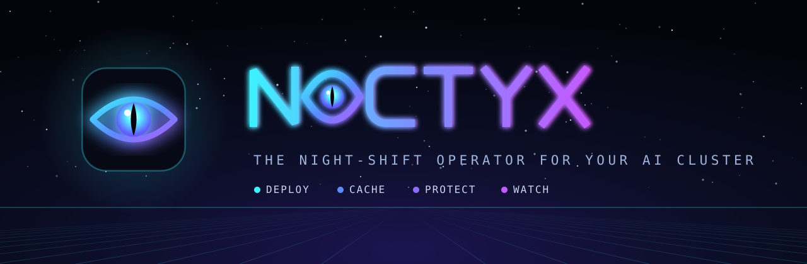</p>

<p align="center">
  
  
  
  
  
  
  
  
  
  
</p>

# Noctyx

The night-shift operator for your AI cluster. One console that **deploys** model recipes safely,
**caches** every model locally, **protects** your machines and data, and **watches** all of it with an
LLM that explains what it sees. Built for DGX Spark pairs, RTX workstations, NAS-backed home labs and
small inference clusters. The head runs on Linux or macOS; the machines it backs up are Linux, and a Mac is
monitored (Time Machine backs it up).

> **Status: alpha (0.1).** Extracted from a single-site implementation that has run a production GPU
> cluster since 2026-09; that cluster now runs on Noctyx. See [docs/PLAN.md](docs/PLAN.md).

| | |
|---|---|
| **Deploy** | Build the next recipe while the current one serves; switch under the GPU lock; roll back automatically. Discover public recipes for your hardware, ranked by measured speed |
| **Cache** | One copy of every Hugging Face model on the cluster, served back as `HF_ENDPOINT`; keeps working when the Hub does not |
| **Protect** | Nightly snapshots of every Linux node, Docker volumes, consistent database dumps, bare-metal restore |
| **Watch** | Live fleet console: temperatures, power, tokens/s per model, alerts with LLM triage, a morning brief |

<p align="center">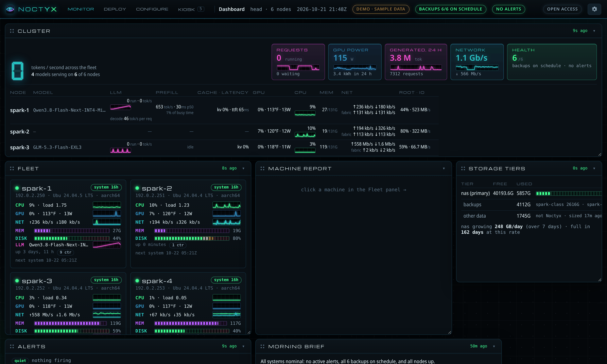</p>

## Screenshots

All taken from `noctyx demo` (sample data from a real cluster, every name and address replaced).
Regenerate them with `python3 tools/screenshots.py`.

| | |
|---|---|
| [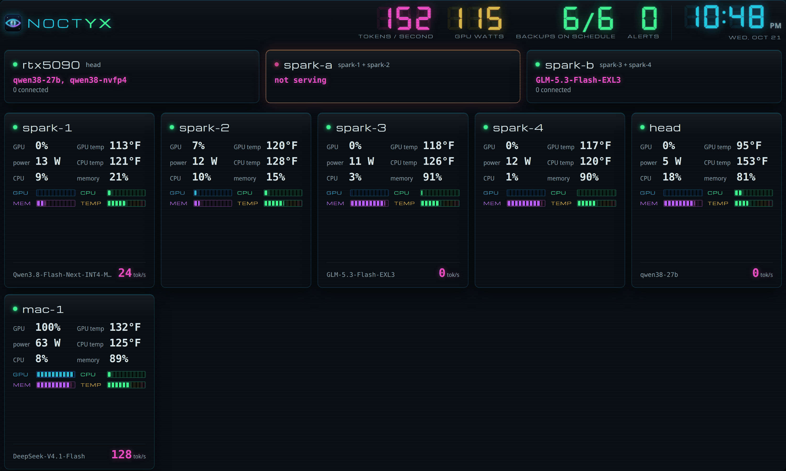](docs/screenshots/phosphor-kiosk.png) **Phosphor.** An instrument panel: segmented LED meters, oscilloscope traces, LCD numerals with their unlit segments, one colour per subsystem everywhere. | [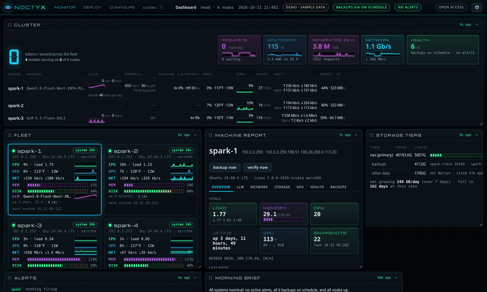](docs/screenshots/phosphor-node.png) **The same, close up.** CPU green, GPU blue, memory violet, network cyan, power yellow, LLM magenta; disks and temperatures run green to amber to red. |
| [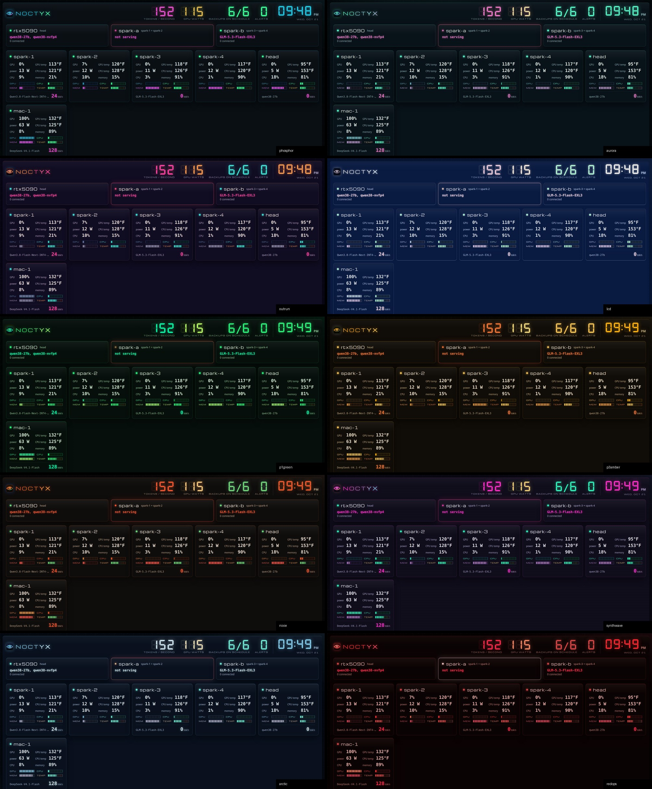](docs/screenshots/phosphor-family.jpg) **The Phosphor family.** Phosphor, Aurora, Outrun, LCD, P1 Green, P3 Amber, Nixie, Synthwave, Arctic and Red Ops (all red, for a dark room); each with a light face, and optional scanlines, vignette, grain, RGB fringe, beam sweep and flicker that cost the GPU next to nothing. | [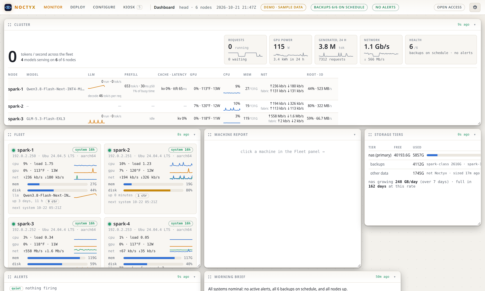](docs/screenshots/theme-ember-light.png) **Classic themes.** Noctyx, Ember, Mono, GitHub, Catppuccin, or your own colours. |
| [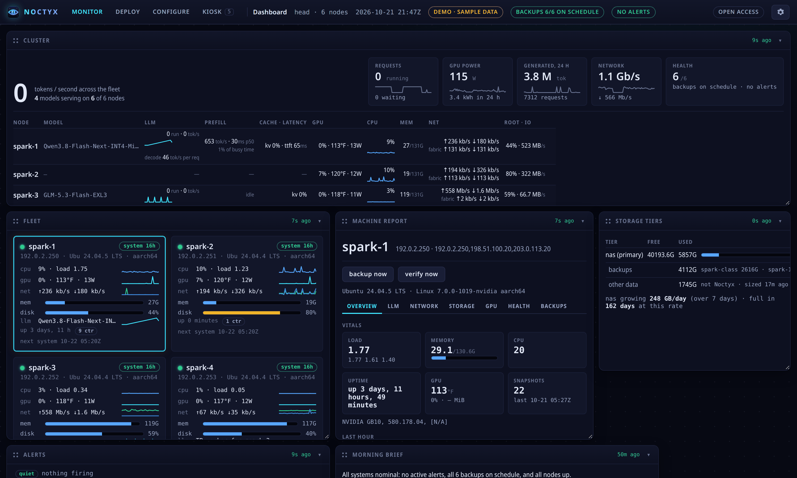](docs/screenshots/node.png) **Machine report.** Click a node: vitals, LLM, network, storage, GPU, health and backup tabs, with backup and verify buttons. | [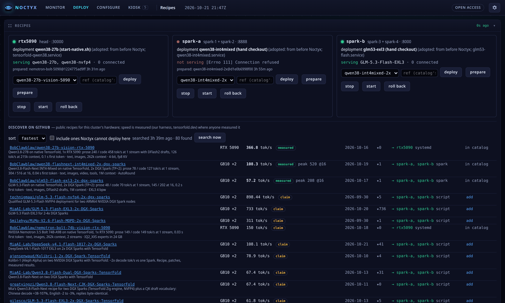](docs/screenshots/recipes.png) **Recipes.** What each GPU slot serves; deploy, prepare, stop, start, roll back; public recipes for your hardware ranked by measured speed. |
| [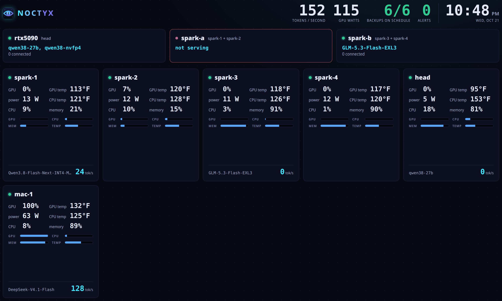](docs/screenshots/kiosk.png) **Kiosk.** A full-screen wall display: fleet tokens/s, GPU watts, backups, alerts, every slot and node. | [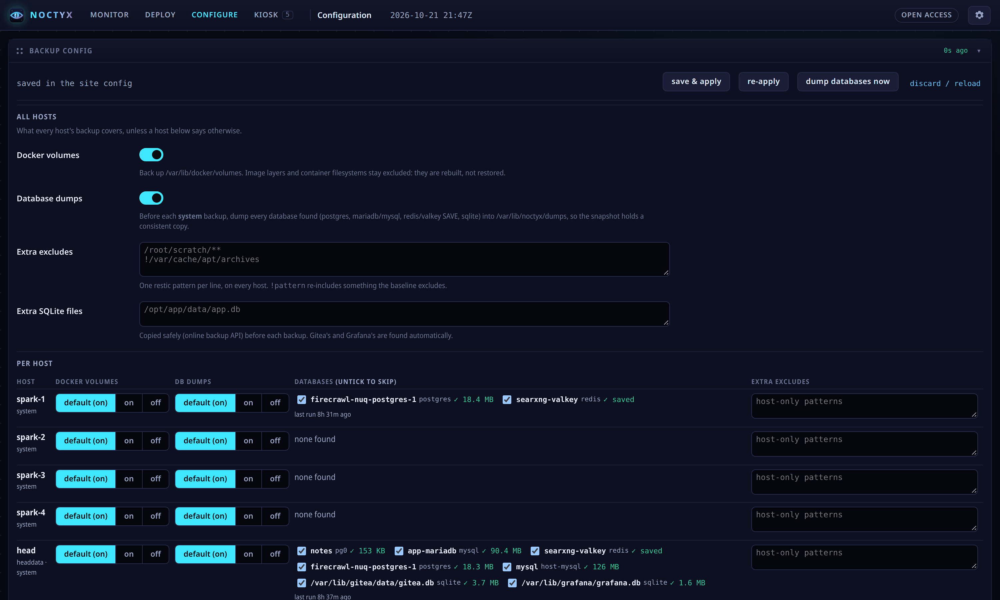](docs/screenshots/config.png) **Configuration.** Backup policy per site and per host, databases found on each machine, retention, the mirror, the assistant. |
| [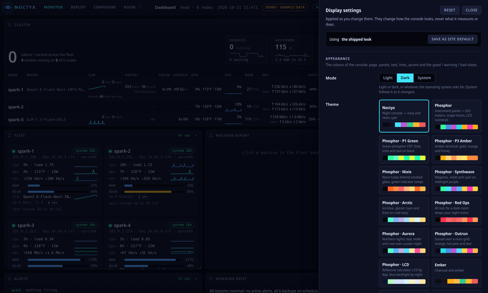](docs/screenshots/settings.png) **Settings drawer.** Fifteen themes plus your own colours, light / dark / system, °F / °C; kept in the browser or in your account. | [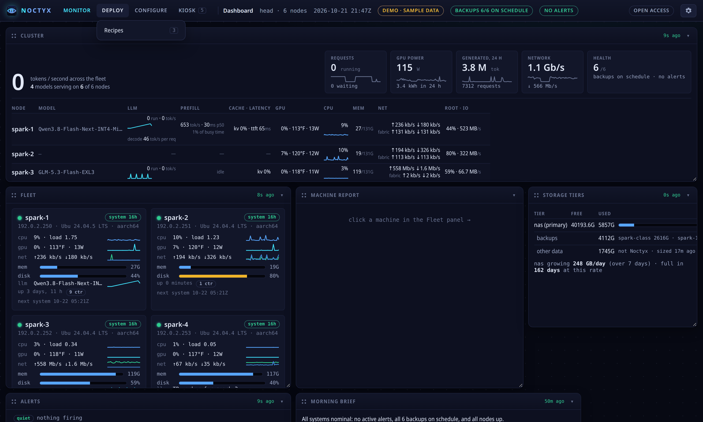](docs/screenshots/menu.png) **Menus.** Monitor, Deploy, Configure, Kiosk; keys 1–5. |
| [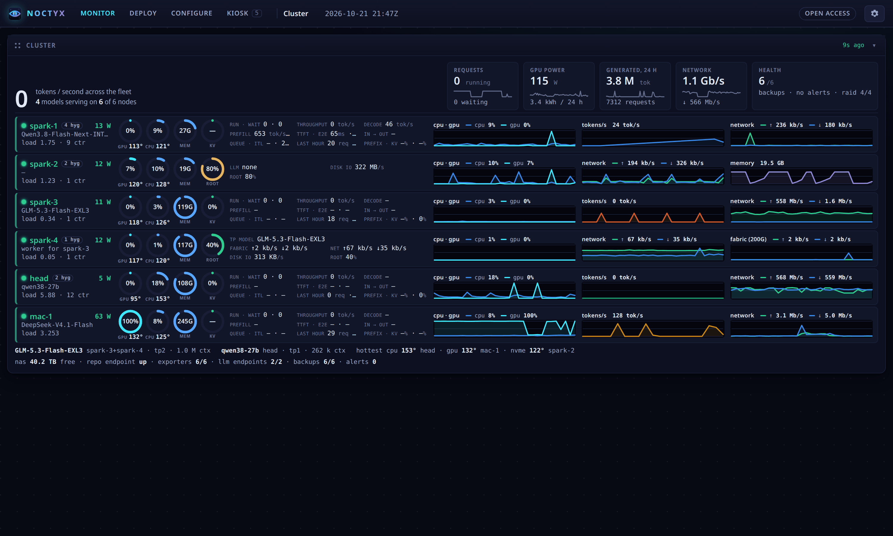](docs/screenshots/cluster.png) **Cluster.** Schedules, snapshots, capacity and hygiene across the fleet. | [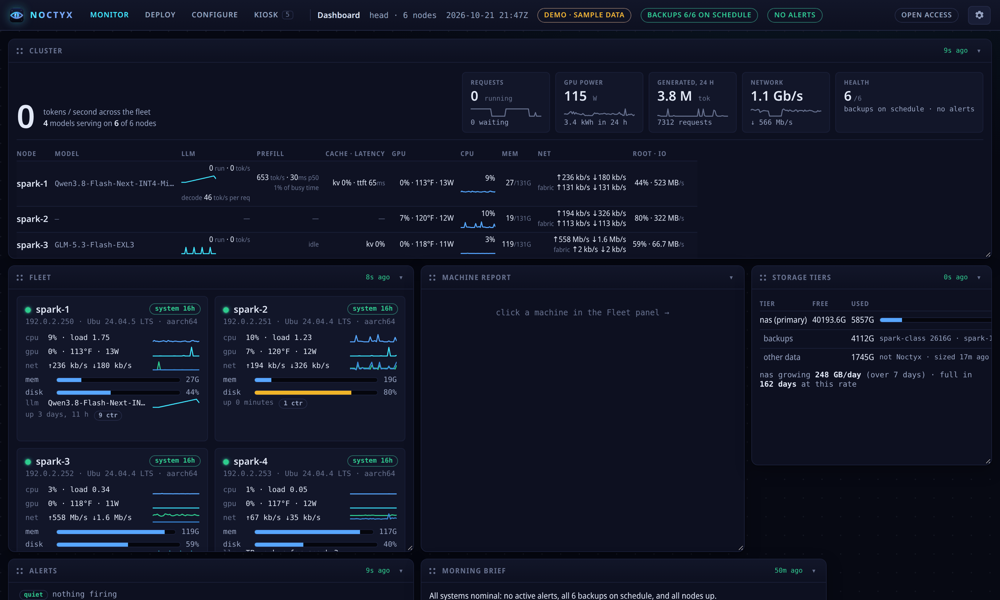](docs/screenshots/dashboard.png) **The Noctyx theme.** The same dashboard in the classic navy and neon cyan. |
| [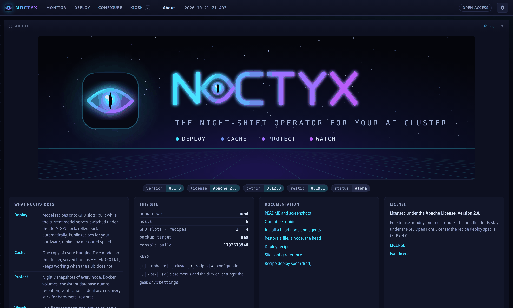](docs/screenshots/about.png) **About.** Version, license, this site, links to the docs. | [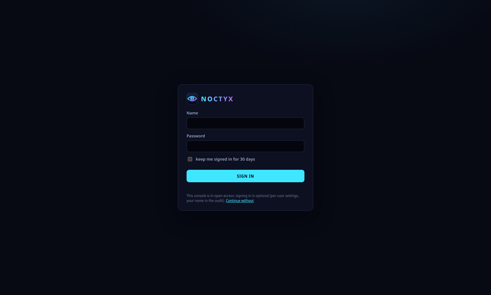](docs/screenshots/login.png) **Sign-in.** Accounts with viewer, operator and admin roles. |

## Features

**Deploy**
- GPU *slots* (one GPU, or a head + worker pair) and a *catalog* of recipes; `noctyx recipe-deploy` builds
  the next recipe while the current one keeps serving, switches under the slot's GPU lock, health-checks
  it and rolls back by itself when it fails.
- Recipe discovery: public recipes on GitHub that fit your hardware, ranked by **measured** speed (your own
  harness runs, tensorfold.dev) ahead of a README's claims.

**Cache**
- A Hugging Face mirror on the head: every node's downloads are harvested into one store and served back
  as `HF_ENDPOINT`, so a model is fetched from the Hub once and keeps loading when the Hub is down.

**Protect**
- restic snapshots of every Linux node to your NAS or a local disk, scheduled per profile, one writer per spindle, inside each profile's
  window, refusing to start over a link slower than a set floor.
- Docker volumes, consistent database dumps (Postgres, MariaDB/MySQL, Redis/Valkey, SQLite) before each
  backup, retention, scheduled verification, capacity forecasts.
- Restore a path to staging, to the host or in place; restore a dead node bare-metal from a recovery stick
  that boots both x86_64 and aarch64; rebuild the head node itself.

**Watch**
- A live fleet console: tokens/s, prefill and latency per model, GPU temperature and power, CPU, memory,
  network fabric, disks, uptime, containers.
- Alerts with LLM triage, a morning brief, Prometheus metrics, a kiosk view.
- Hygiene: old kernels, unused packages, journal and Docker leftovers per node, with the space each fix frees.
- Every critical component on every machine (restic, rest-server, Prometheus, node_exporter, the agent) checked
  nightly against Noctyx's pin and the latest release, with the command that upgrades it, as alerts.
- Macs are monitored, not backed up: vitals, GPU power, LLM servers and their Time Machine status.

**Run it your way**
- Pure Python standard library on the head, on Linux (systemd) or macOS (launchd); bash and restic on the nodes.
  No database, no containers needed.
- First-time setup by questions (`noctyx init`), the site's LLM set up first so it can explain any step that
  fails, then `noctyx setup all` and an end-to-end `noctyx setup verify`.
- Accounts with roles, or open access on a LAN you trust. Themes. An audit log of every action.

## Documentation

| Guide | |
|---|---|
| [Install](docs/guide/install.md) | Linux or macOS head: init, setup, verify; agents, the first backup, versions, the demo |
| [Console](docs/guide/console.md) | every view, settings and themes, keys |
| [Site config](docs/guide/site-config.md) | every block and key, the `paths` layer |
| [Backups](docs/guide/backups.md) | schedules, policy, databases, retention, verification |
| [Restore](docs/guide/restore.md) | a file, a whole node, the head node; the recovery stick |
| [Recipes](docs/guide/recipes.md) | slots, catalog, deploy and roll back, discovery |
| [HF mirror](docs/guide/hf-mirror.md) | the model cache and `HF_ENDPOINT` |
| [Assistant](docs/guide/assistant.md) | the LLM endpoint, triage, the morning brief |
| [Hygiene](docs/guide/hygiene.md) | housekeeping reports and fixes |
| [Accounts](docs/guide/accounts.md) | sign-in, roles, sessions |
| [Upgrade](docs/guide/upgrade.md) | upgrading, rolling back, moving from an older layout |
| [Troubleshooting](docs/guide/troubleshooting.md) | what an error means and what to do |

Try it without a cluster: `PYTHONPATH=src python3 -m noctyx.cli demo` serves the console on
sample data at `http://127.0.0.1:20993` (read-only).

## Install (head node, Linux or macOS)

```bash
git clone https://github.com/BobClawblaw/noctyx.git /opt/noctyx-src      # not on PyPI yet
sudo python3 -m venv /opt/noctyx                  # macOS: Homebrew's python3 (/opt/homebrew/bin/python3)
sudo /opt/noctyx/bin/pip install /opt/noctyx-src && sudo ln -sf /opt/noctyx/bin/noctyx /usr/local/bin/noctyx
sudo noctyx init                          # questions: the assistant first, then this machine, storage, nodes, sign-in
sudo noctyx setup all                     # tools, owner, mount, TLS, repositories, endpoint, services, metrics (+ privacy on macOS)
sudo noctyx setup verify                  # every check, and a backup + restore round trip through the endpoint
sudo noctyx install-agent                 # each Linux node: restic, the agent, keys (never on a command line)
```

The same commands set up a Linux head (systemd units) or a macOS head (launchd daemons; one Full Disk Access
grant at the Mac's screen when the repositories are on a NAS). See [the install guide](docs/guide/install.md).
The console is at `https://<head>:20996`. Everything a site differs in lives in its config
(`NOCTYX_CONFIG`, default `/etc/noctyx/site.json`): hosts, the NAS, schedules, retention, backup policy,
the HF mirror, recipe slots and catalog, the assistant's LLM endpoint.

**An existing layout.** Every file, unit and user name Noctyx touches is in
[`src/noctyx/paths.py`](src/noctyx/paths.py); a site's `"paths"` block overrides any of them, so a cluster
set up by an earlier tool keeps its directories, agent and unit names and moves when it wants to.
`noctyx paths` prints what is in effect.

## Accounts

```bash
sudo noctyx user add --name alice --role admin     # viewer | operator | admin; the password is asked twice
sudo noctyx user list | passwd | role | del
```

With `server.console_auth` on (the default) and at least one user, the console asks everyone to sign in;
viewers look, operators run jobs, admins change configuration. With `console_auth: false` (a LAN you
trust) it stays open and signing in is optional: it keeps your display settings in your account and puts
your name in the audit log.

## License

Noctyx is licensed under the **Apache License, Version 2.0** — free to use, modify and
redistribute. See [LICENSE](LICENSE).

## Donations

Noctyx is free and open source, forever. If it saves you a night, a re-download or a dead node, tips keep it going:

**Bitcoin:** `bc1q9echf820hapc04y0f636uxdry2ahyx32tkleff`

"Noctyx" is a trademark of its owner; the Apache 2.0 license grants no rights in the name or logo.
