<p align="center">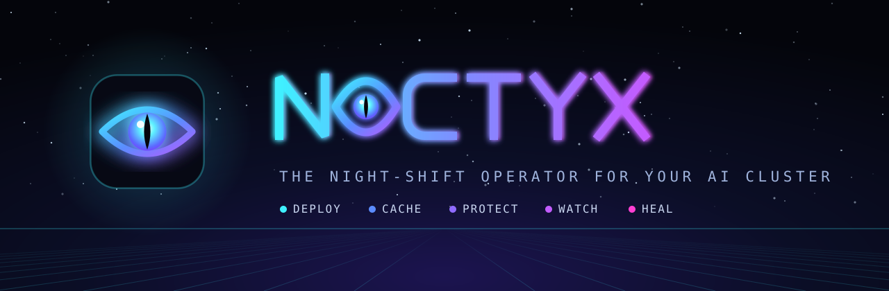</p>

<p align="center">
  
  
  
  
  
  
  
  
  
  
  <a href="https://bobclawblaw.github.io/noctyx/"></a>
</p>

# Noctyx

The night-shift operator for your AI cluster. One console that **deploys** model recipes safely,
**caches** every model locally, **protects** your machines and data, **watches** all of it with an
LLM that explains what it sees, and **heals** what breaks. Built for DGX Spark pairs, RTX workstations, NAS-backed home labs and
small inference clusters. The head runs on Linux or macOS; the machines it backs up are Linux, and a Mac is
monitored (Time Machine backs it up).

> **Status: alpha (0.9.6).** Extracted from a single-site implementation that has run a production GPU
> cluster since 2026-09; that cluster now runs on Noctyx. See [docs/PLAN.md](docs/PLAN.md) for what is built,
> what was added lately and what is still open.

| | |
|---|---|
| **Deploy** | Build the next recipe while the current one serves; switch under the GPU lock; roll back automatically. Supports the open `recipe.toml` `[deploy]` spec and ranks public recipes by measured speed |
| **Cache** | One copy of every Hugging Face model on the cluster, served back as `HF_ENDPOINT` with optional atomic write-through caching; keeps working when the Hub does not |
| **Protect** | Nightly snapshots of every Linux node, Docker volumes, consistent database dumps, 3-2-1 copy to S3 / Backblaze B2 / REST / SFTP / local targets, bare-metal restore |
| **Watch** | Live fleet console (15 themes, split CSS/JS), temperatures, power, tokens/s per model, alerts routed to phones/chat/email (Linux & macOS), LLM triage, morning brief, and Ask Noctyx |
| **Heal** | Every upgrade checks itself and rolls back when it fails; a repair loop puts back what drifts and restarts what stops, and tells you what it did |

<p align="center">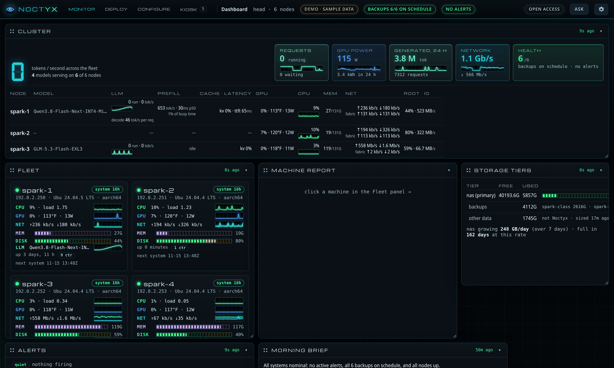</p>

<p align="center">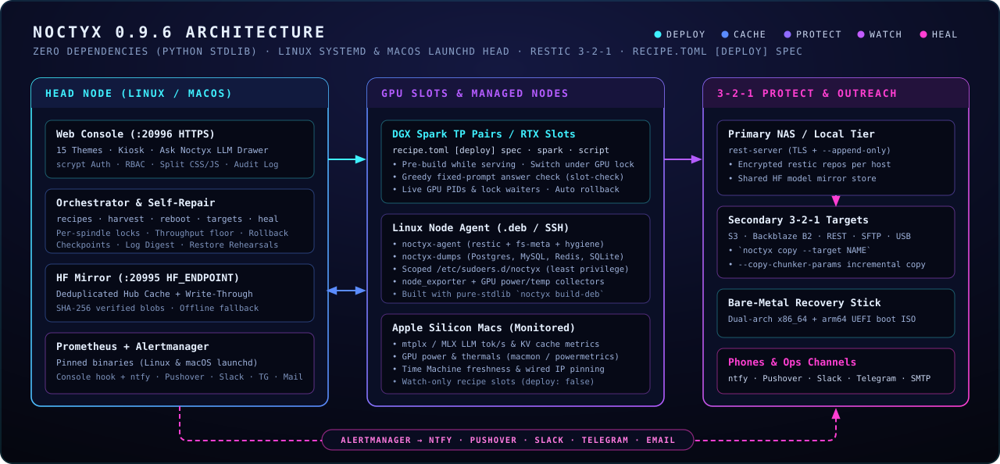</p>

## New in 0.9.6

- **Declarative `[deploy]` recipe spec v0:** repos shipping `recipe.toml` with a `[deploy]` block (`kind: "spec"`) are discovered automatically and deployed without custom shell glue ([spec](docs/spec/recipe-deploy.md) · [recipes guide](docs/guide/recipes.md)).
- **Secondary 3-2-1 backup targets:** incremental `restic copy --copy-chunker-params` to S3, Backblaze B2, REST, SFTP, or local/USB targets via `noctyx target-set`, `noctyx copy --target`, `noctyx verify-target`, and **Configuration › Secondary backup targets** ([backups guide](docs/guide/backups.md)).
- **Atomic write-through HF mirror:** optional `hf_mirror.write_through` streams cache misses directly into the shared mirror store with SHA-256 verification and atomic rename (`X-CM-Mirror: write-through`) ([HF mirror guide](docs/guide/hf-mirror.md)).
- **External alert routing + macOS Alertmanager:** send alerts to phones, chat, and email (`ntfy`, `Pushover`, `Slack`, `Telegram`, `SMTP`, generic webhooks) via `noctyx alerting-set`, `noctyx setup alerting`, `noctyx alerting-test`, and **Configuration › External alert routing** — now on both Linux (`systemd`) and macOS (`launchd`) heads ([install guide](docs/guide/install.md)).
- **Debian `.deb` node packager & least-privilege sudoers:** build `noctyx-agent_<ver>_all.deb` with pure Python stdlib (`noctyx build-deb`) and generate scoped `/etc/sudoers.d/noctyx` rules (`noctyx sudoers`) ([install guide](docs/guide/install.md)).
- **Security & modularization:** immediate session invalidation on password change (`session_epoch`), expanded admin-only action gating ([accounts guide](docs/guide/accounts.md)), split console CSS/JS assets, and modularized `reboot`, `harvest`, and `recipes` engines.

## Screenshots

All taken from `noctyx demo` (sample data from a real cluster, every name and address replaced).
Regenerate them with `python3 tools/screenshots.py`.

| | |
|---|---|
| [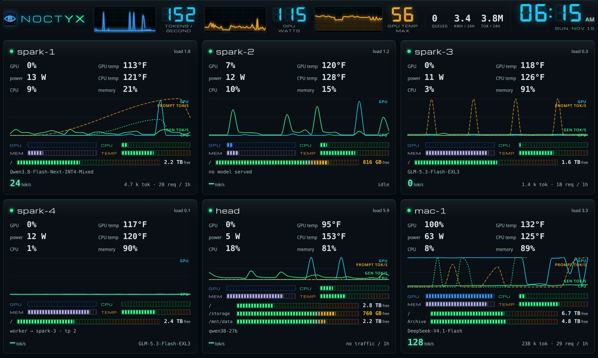](docs/screenshots/phosphor-kiosk.png) **Phosphor.** An instrument panel: segmented LED meters, oscilloscope traces, LCD numerals with their unlit segments, one colour per subsystem everywhere. | [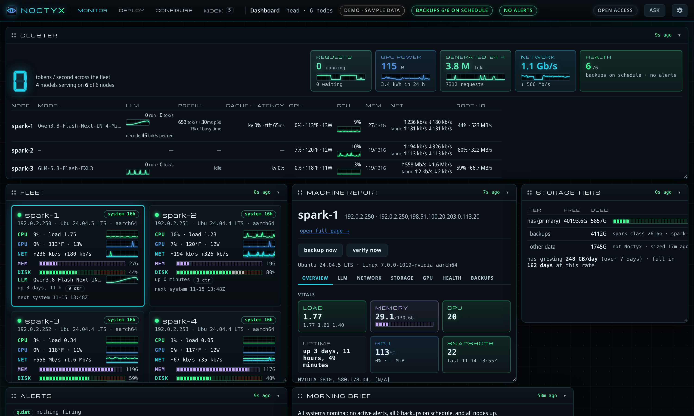](docs/screenshots/phosphor-node.png) **The same, close up.** CPU green, GPU blue, memory violet, network cyan, power yellow, LLM magenta; disks and temperatures run green to amber to red. |
| [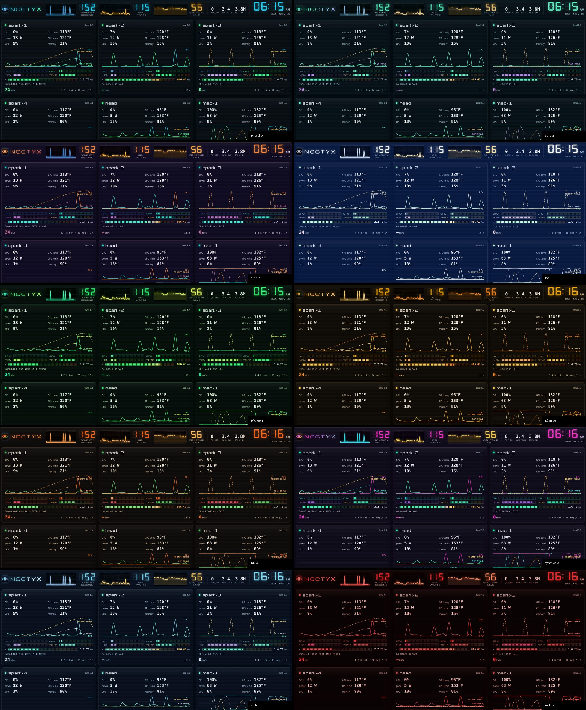](docs/screenshots/phosphor-family.jpg) **The Phosphor family.** Phosphor, Aurora, Outrun, LCD, P1 Green, P3 Amber, Nixie, Synthwave, Arctic and Red Ops (all red, for a dark room); each with a light face, and optional scanlines, vignette, grain, RGB fringe, beam sweep and flicker that cost the GPU next to nothing. | [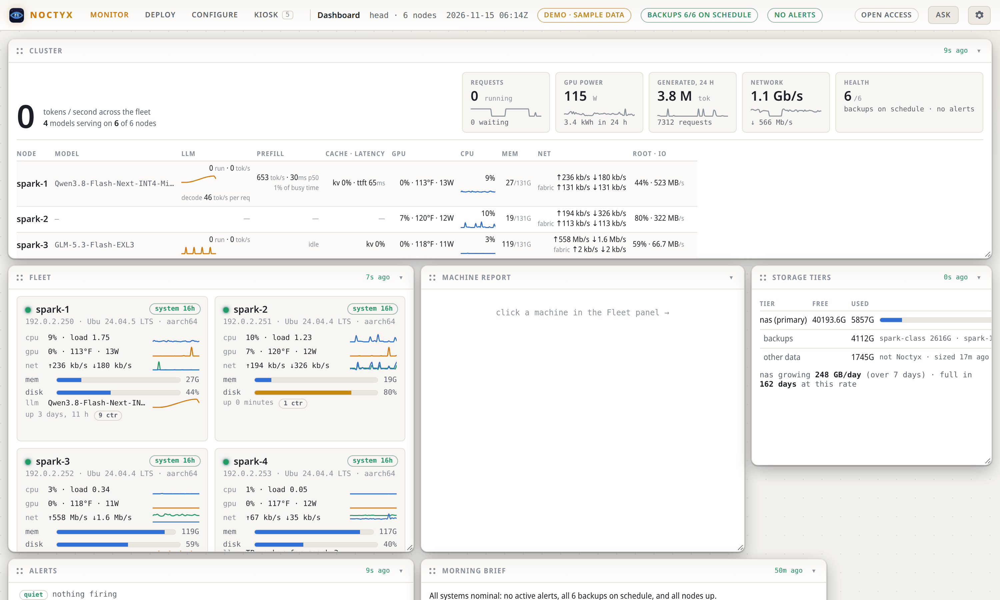](docs/screenshots/theme-ember-light.png) **Classic themes.** Noctyx, Ember, Mono, GitHub, Catppuccin, or your own colours. |
| [](docs/screenshots/node.png) **Machine report.** Click a node: vitals, LLM, network, storage, GPU, health and backup tabs, with backup and verify buttons. | [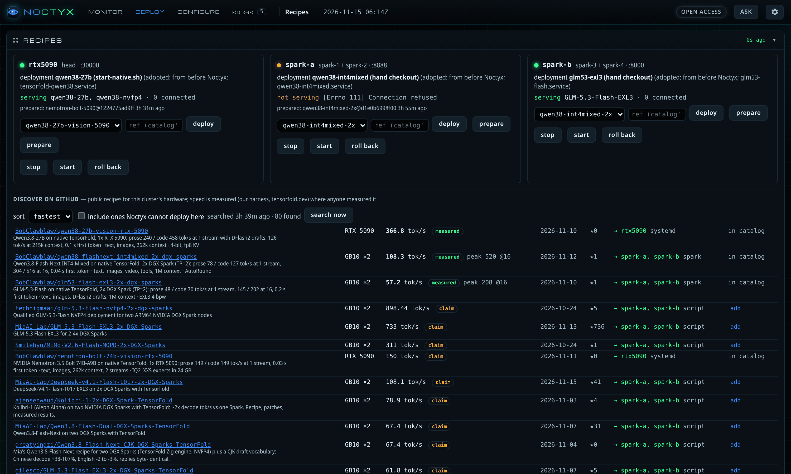](docs/screenshots/recipes.png) **Recipes.** What each GPU slot serves; deploy, prepare, stop, start, roll back; public recipes for your hardware ranked by measured speed. |
| [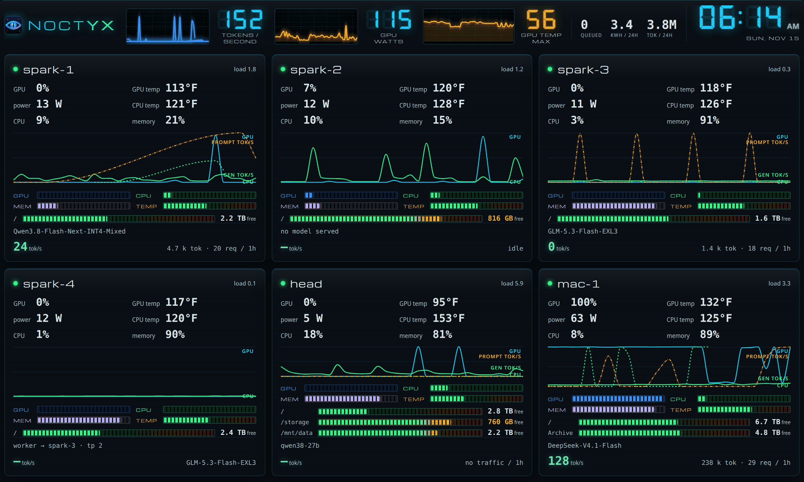](docs/screenshots/kiosk.png) **Kiosk.** A full-screen wall display: fleet tokens/s, GPU watts, backups, alerts, every slot and node. | [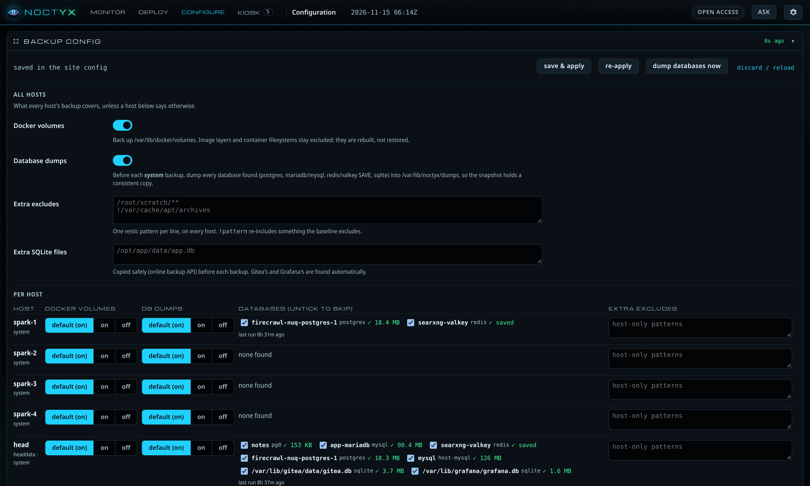](docs/screenshots/config.png) **Configuration.** Backup policy per site and per host, databases found on each machine, retention, the HF mirror (including write-through), secondary 3-2-1 targets, external alert routing, the assistant, self-repair, and checkpoints. |
| [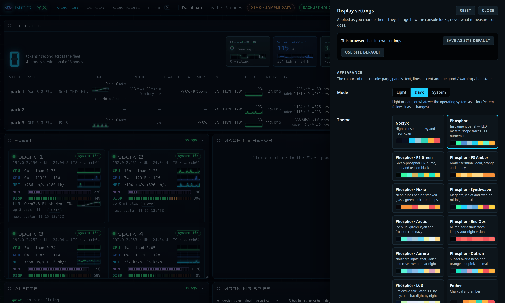](docs/screenshots/settings.png) **Settings drawer.** Fifteen themes plus your own colours, light / dark / system, °F / °C; kept in the browser or in your account. | [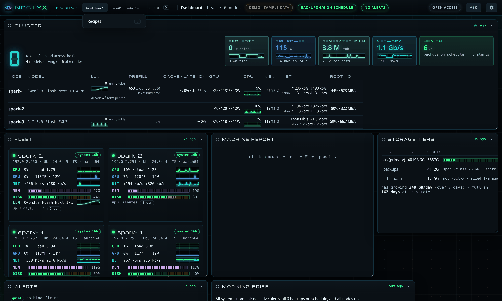](docs/screenshots/menu.png) **Menus.** Monitor, Deploy, Configure, Kiosk; keys 1–5. |
| [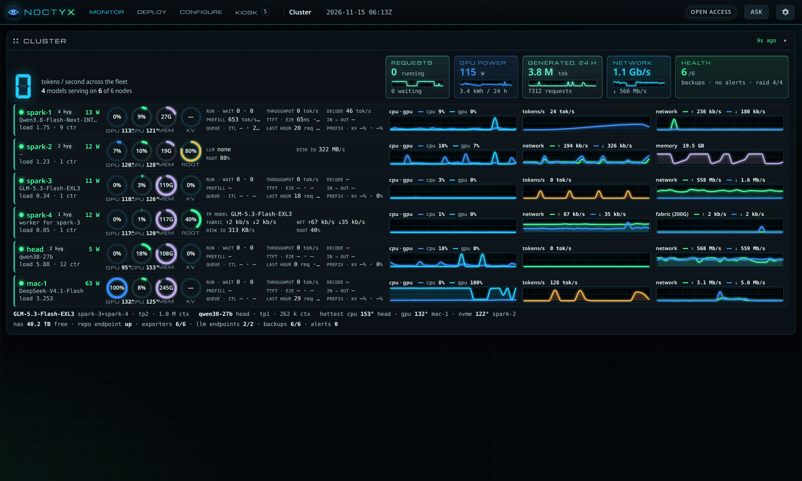](docs/screenshots/cluster.png) **Cluster.** Schedules, snapshots, capacity and hygiene across the fleet. | [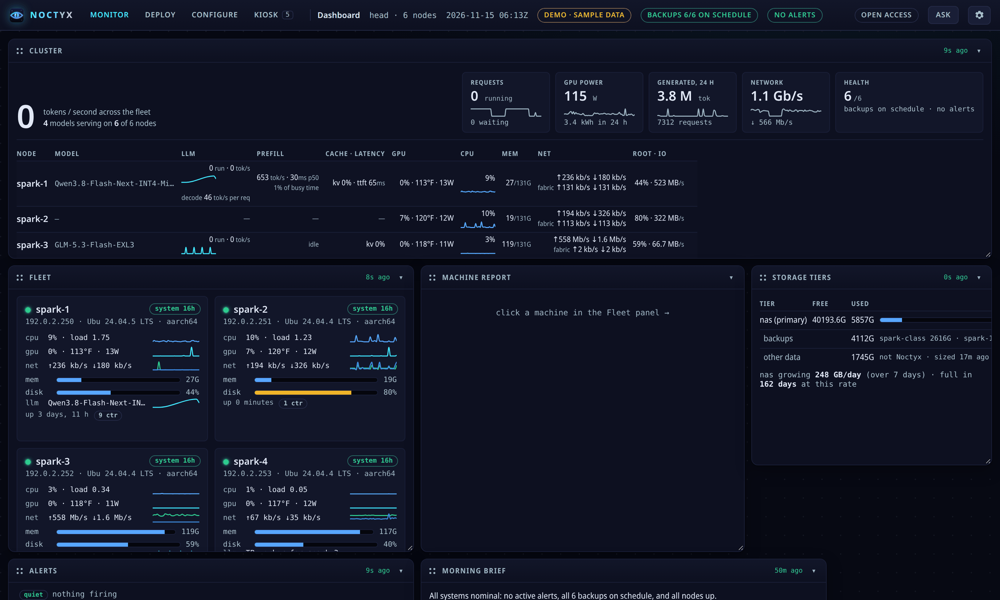](docs/screenshots/dashboard.png) **The Noctyx theme.** The same dashboard in the classic navy and neon cyan. |
| [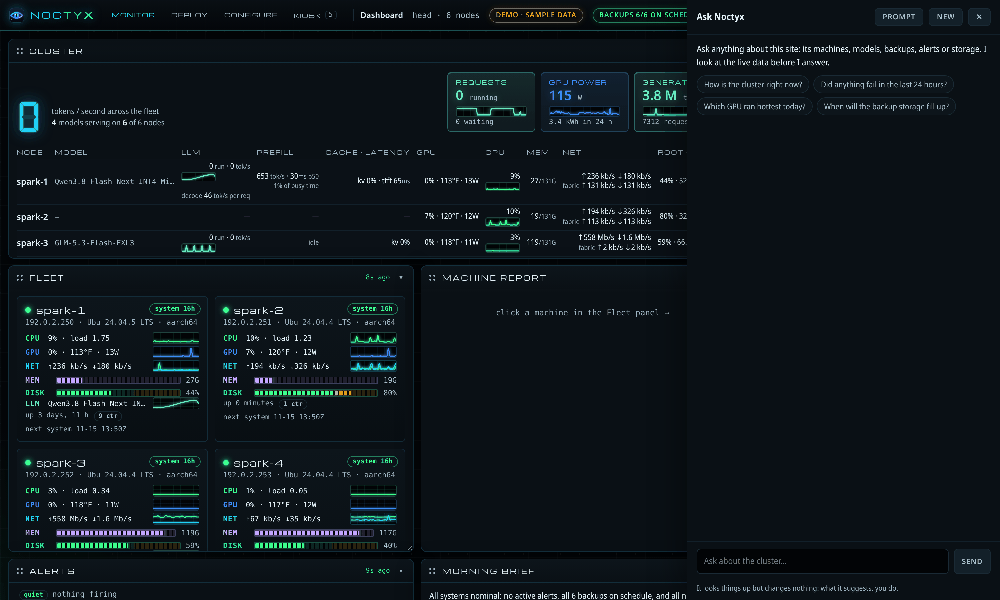](docs/screenshots/ask.png) **Ask Noctyx.** Questions about the cluster, answered by the site's LLM after it looks at the live data; it only looks, and says what would change things. | [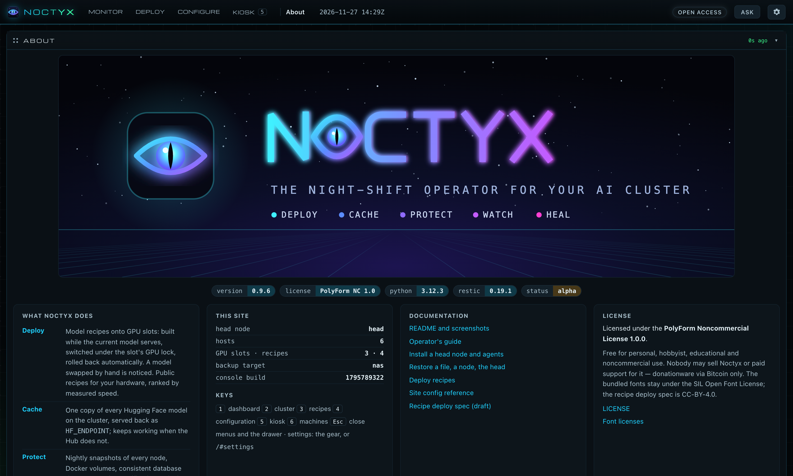](docs/screenshots/about.png) **About.** Version, license, this site, links to the docs. |
| [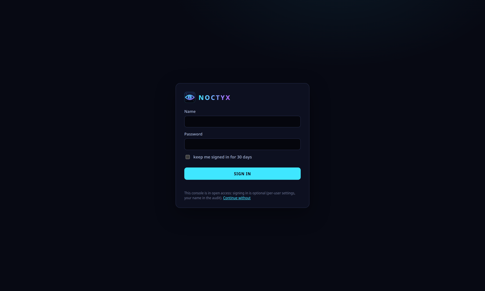](docs/screenshots/login.png) **Sign-in.** Accounts with viewer, operator and admin roles. | |

## Features

**Deploy**
- GPU *slots* (one GPU, or a head + worker pair) and a *catalog* of recipes; `noctyx recipe-deploy` builds
  the next recipe while the current one keeps serving, switches under the slot's GPU lock, health-checks
  it and rolls back by itself when it fails.
- A model that is up but answering differently is noticed: each slot's model is asked a few fixed prompts after
  every switch and every hour, and its replies are compared with the ones recorded for that deployment
  (`noctyx slot-check`).
- Each slot shows who is on its GPU: the processes using it, who holds its lock and who waits for it.
- A model somebody swapped by hand is noticed: a slot that serves other models than its recorded deployment
  is reported by self-repair after 15 minutes and raises an alert 15 minutes later, and `noctyx recipe-adopt`
  records what serves now. A watch-only slot
  (`"deploy": false`) is reported and never switched.
- Recipe discovery: public recipes on GitHub that fit your hardware, ranked by **measured** speed (your own
  harness runs, tensorfold.dev) ahead of a README's claims. Repos declaring the open [`[deploy]` spec](docs/spec/recipe-deploy.md)
  in `recipe.toml` (`kind: "spec"`) are detected automatically and deployed with no adapter.

**Cache**
- A Hugging Face mirror on the head: every node's downloads are harvested into one store and served back
  as `HF_ENDPOINT`, with optional atomic write-through caching (`hf_mirror.write_through`) that verifies
  SHA-256 and caches weights on the first pull, so models keep loading when the Hub is down.

**Protect**
- restic snapshots of every Linux node to your NAS or a local disk, scheduled per profile, one writer per spindle, inside each profile's
  window, refusing to start over a link slower than a set floor.
- Secondary 3-2-1 backup targets (`backup_targets`): copy primary snapshots incrementally (`--copy-chunker-params`)
  to S3, Backblaze B2, a remote REST server, SFTP, or a second local disk (`noctyx copy --target NAME`, or from the Config page), with credentials in root-only env files.
- Docker volumes, consistent database dumps (Postgres, MariaDB/MySQL, Redis/Valkey, SQLite) before each
  backup, retention, scheduled verification, capacity forecasts.
- Restores are rehearsed: every node regularly restores a few files from its newest snapshot and compares them
  with the live ones (`noctyx rehearse`, monthly by default), with an alert when one fails or is overdue.
- Restore a path to staging, to the host or in place; restore a dead node bare-metal from a recovery stick
  that boots both x86_64 and aarch64; rebuild the head node itself.

**Watch**
- A live fleet console: tokens/s, prefill and latency per model, GPU temperature and power, CPU, memory,
  network fabric, disks, uptime, containers.
- Alerts with LLM triage, a morning brief, Prometheus metrics, a kiosk view, and external phone/chat/email
  alert routing (`ntfy`, `Pushover`, `Slack`, `Telegram`, `webhook`, `email`) via Alertmanager on both Linux
  and macOS heads (`noctyx alerting-set`, `noctyx setup alerting`, or **Configuration › External alert routing**).
- Hygiene: old kernels, unused packages, journal and Docker leftovers per node, with the space each fix frees.
  The daily run fixes what cannot break anything, plus the space items a site hands to it (`noctyx hygiene-set`);
  exited containers and failed units always wait for a person.
- **Ask Noctyx**: a drawer in the console where the site's LLM answers questions about the cluster by looking
  them up first (live metrics, Prometheus history, alerts, backups, logs, versions, what Noctyx repaired),
  within the asker's role, with every secret redacted before the model sees it. It only looks; it says which
  page, button or command would change things, and for a short list of safe actions (a backup, a verify, a
  hygiene fix, an upgrade) it can put the button in the conversation: the click is yours and goes through the
  console's usual checks. Up and Down recall earlier questions.
- The assistant uses any model server on the site: its own endpoint first, then the others, with an alert when
  none answers.
- Every critical component on every machine (restic, rest-server, Prometheus, Alertmanager, node_exporter, the
  agent) checked nightly against Noctyx's pin and the latest release, as alerts with an upgrade button. A site
  can take a newer Prometheus, Alertmanager or node_exporter than Noctyx pins (`noctyx versions-pin`, or the
  alert's *take* button), verified against the release's own SHA-256 sums. Each offered release comes with what
  it changes, read from its release notes by the site's LLM.
- A nightly log digest: every node's warnings and errors counted by kind, and the kinds no earlier night had,
  with the LLM's reading of which matter (`noctyx log-digest`).
- `noctyx status`: each host's newest path speed, the last actions in plain words.
- Macs are monitored, not backed up: vitals, GPU power, LLM servers and their Time Machine status.

**Heal**
- Every upgrade is a transaction: check first, keep what it replaces, change, check the result the way it is
  used (a scrape within the timeout, every target and rule still working), and roll back on any failure.
- Fleet rollouts change one machine first, watch it, then the rest one at a time, and stop at the first failure.
  A failed upgrade cancels the queued ones like it.
- Takes over a distro's Prometheus and Alertmanager with its pinned releases: a 2.x → 3.x move runs a trial on a
  copy of the data beside the old one first, and switches only when the two agree.
- `noctyx heal`, every 5 minutes and at once when an alert fires: restarts failed services, undoes its own recent
  upgrade that broke something, puts back drifted config and alert rules, refreshes stale collectors, clears a
  full disk's journal and package cache (never Docker), restarts the units and model servers you allow, and, if
  you turn it on, upgrades components in a nightly window. A per-hour budget, a freeze after repeated failures,
  and shadow mode keep it safe. Every decision and command is in its log (the Self-repair page), the audit trail,
  the morning brief and Ask Noctyx.
- What it leaves to a person comes with a diagnosis: the site's LLM reads that machine's logs, Noctyx's recent
  changes and the audit trail, and writes a likely cause and a next step under the problem. It only reads.
- Checkpoints: before an upgrade or an apt run, a restic snapshot of the machine (a recent nightly one counts).
  `noctyx revert` undoes any change still in effect, from its kept copy or that snapshot; the site config keeps
  its history; `noctyx self-rollback` takes Noctyx itself back to the commit it ran before.

**Run it your way**
- Pure Python standard library on the head, on Linux (systemd) or macOS (launchd); bash and restic on the nodes.
  No database, no containers needed. Build a Linux node `.deb` package anywhere with `noctyx build-deb`, and
  generate scoped least-privilege `/etc/sudoers.d/noctyx` rules with `noctyx sudoers`.
- First-time setup by questions (`noctyx init`), or in a browser (`noctyx init --web`, the assistant proposing
  each step), the site's LLM set up first so it can explain any step that fails, then `noctyx setup all` and an
  end-to-end `noctyx setup verify`.
- Accounts with roles (password changes immediately invalidate old sessions), or open access on a LAN you trust. Themes. An audit log of every action.

## Documentation

Browse the full searchable documentation, interactive screenshot tour, and architecture overview on the **[Noctyx GitHub Pages site](https://bobclawblaw.github.io/noctyx/)** (or read the guides directly below):

| Guide | |
|---|---|
| [Install](docs/guide/install.md) | Linux or macOS head: init, setup, verify; agents, the first backup, versions, the demo |
| [Console](docs/guide/console.md) | every view, settings and themes, keys |
| [Site config](docs/guide/site-config.md) | every block and key, the `paths` layer |
| [Backups](docs/guide/backups.md) | schedules, policy, databases, retention, verification |
| [Restore](docs/guide/restore.md) | a file, a whole node, the head node; restore rehearsals; the recovery stick |
| [Recipes](docs/guide/recipes.md) | slots, catalog, deploy and roll back, the answer check, a model swapped by hand, watch-only slots, discovery |
| [HF mirror](docs/guide/hf-mirror.md) | the model cache and `HF_ENDPOINT` |
| [Assistant](docs/guide/assistant.md) | the LLM endpoint and its fallbacks, triage, diagnosis, the morning brief, Ask and the buttons it offers |
| [Hygiene](docs/guide/hygiene.md) | housekeeping reports and fixes, what the daily run fixes on its own |
| [Accounts](docs/guide/accounts.md) | sign-in, roles, sessions |
| [Upgrade](docs/guide/upgrade.md) | upgrading, component versions and a site's own pins, rolling back, moving from an older layout |
| [Early warnings](docs/guide/signals.md) | NFS and NAS speed, the GPU pairs' RoCE link, ssh logins, storage filling up: alerts before they break |
| [Checkpoints](docs/guide/checkpoints.md) | restic checkpoints before upgrades and apt, `noctyx revert`, the site config's history, `noctyx self-rollback` |
| [Self-repair](docs/guide/self-repair.md) | `noctyx heal`: its playbooks, its safety rules, the diagnosis of what it leaves to a person, automatic upgrades, and its log |
| [Troubleshooting](docs/guide/troubleshooting.md) | what an error means and what to do |

Try it without a cluster: `PYTHONPATH=src python3 -m noctyx.cli demo` serves the console on
sample data at `http://127.0.0.1:20993` (read-only).

## Install (head node, Linux or macOS)

```bash
git clone https://github.com/BobClawblaw/noctyx.git /opt/noctyx-src      # not on PyPI yet
sudo python3 -m venv /opt/noctyx                  # macOS: Homebrew's python3 (/opt/homebrew/bin/python3)
sudo /opt/noctyx/bin/pip install /opt/noctyx-src && sudo ln -sf /opt/noctyx/bin/noctyx /usr/local/bin/noctyx
sudo noctyx init                          # questions: the assistant first, then this machine, storage, nodes, sign-in
sudo noctyx setup all                     # tools, owner, mount, TLS, repositories, endpoint, services, metrics (+ privacy on macOS)
sudo noctyx setup verify                  # every check, and a backup + restore round trip through the endpoint
sudo noctyx install-agent                 # each Linux node: restic, the agent, keys (never on a command line)
```

The same commands set up a Linux head (systemd units) or a macOS head (launchd daemons; one Full Disk Access
grant at the Mac's screen when the repositories are on a NAS). See [the install guide](docs/guide/install.md).
The console is at `https://<head>:20996`. Everything a site differs in lives in its config
(`NOCTYX_CONFIG`, default `/etc/noctyx/site.json`): hosts, the NAS, schedules, retention, backup policy,
the HF mirror, recipe slots and catalog, the assistant's LLM endpoint.

**An existing layout.** Every file, unit and user name Noctyx touches is in
[`src/noctyx/paths.py`](src/noctyx/paths.py); a site's `"paths"` block overrides any of them, so a cluster
set up by an earlier tool keeps its directories, agent and unit names and moves when it wants to.
`noctyx paths` prints what is in effect.

## Accounts

```bash
sudo noctyx user add --name alice --role admin     # viewer | operator | admin; the password is asked twice
sudo noctyx user list | passwd | role | del
```

With `server.console_auth` on (the default) and at least one user, the console asks everyone to sign in;
viewers look, operators run jobs, admins change configuration. With `console_auth: false` (a LAN you
trust) it stays open and signing in is optional: it keeps your display settings in your account and puts
your name in the audit log.

## License

Noctyx is licensed under the **[PolyForm Noncommercial License 1.0.0](LICENSE)** (source-available, noncommercial).
It is **100% free** for personal, hobbyist, educational, public research, charitable, and other noncommercial use —
you may read, modify, and share it freely for noncommercial purposes.

**Nobody is allowed to sell Noctyx, offer paid hosted/managed Noctyx, or sell paid support for it.**

## Donations

Noctyx is free donationware, forever — no paid tiers, no paid support, no subscriptions. If it saves you a night, a
re-download, or a dead node, voluntary Bitcoin tips are always appreciated:

**Bitcoin:** `bc1q9echf820hapc04y0f636uxdry2ahyx32tkleff`

"Noctyx" is a trademark of its owner; the license grants no rights in the name or logo. The bundled console fonts stay
under the SIL Open Font License, and the recipe deploy spec (`docs/spec/recipe-deploy.md`) is CC-BY-4.0.
